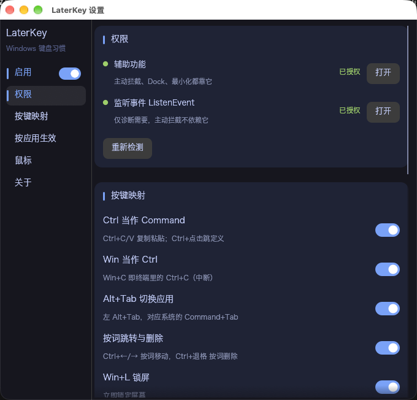
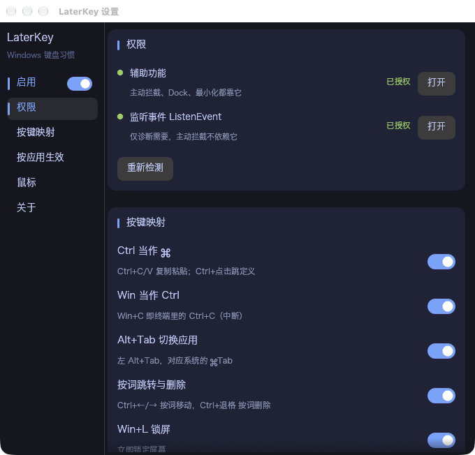

# LaterKey

[](LICENSE) [](https://github.com/crazykun/homebrew-ailater)

**不装驱动的 Karabiner 替代品** —— Windows 布局的普通键盘插上 Mac，Ctrl+C 原地就能复制。

纯用户态实现，不装虚拟 HID 驱动、不用写 JSON 配置。图形界面和终端同时符合 Windows 习惯。





## 为什么是 LaterKey

用普通键盘配 Mac，最别扭的一件事：手指按 Ctrl+C，macOS 只认 ⌘C。系统自带的「修饰键互换」只解决一半——界面能复制了，终端里的 Ctrl+C（中断信号）却跟着没了。

LaterKey 在用户态拦截按键，按角色分流：

- **图形界面**：物理 Ctrl → ⌘，Ctrl+C/V/X/A/Z 全部按 Windows 手感走；
- **终端控制**：物理 Win → ⌃，Win+C 中断、Win+D 结束输入，控制键一个不少；
- **Windows 特色键**：Alt+Tab 切应用、Win+L 锁屏、F2 重命名、Ctrl+点击跳转定义，一并补齐。

不用判断当前在哪个应用，两套习惯同时成立。

### 和现有方案比

| | LaterKey | Karabiner-Elements | 系统修饰键互换 |
|---|---|---|---|
| 虚拟 HID 驱动 | ❌ 不装 | ✅ 要装 DriverKit | ❌ 不装 |
| 配置方式 | 托盘 / 设置面板点点点 | 手写 JSON 规则 | 只能两两互换 |
| 终端中断键 | Win+C 独立保留 | 需自己配应用排除 | 与复制冲突 |
| Alt+Tab / Win+L / 剪贴板历史 | 内置 | 自己找规则写 | 无 |
| App 升级后 | 授权跨版本有效，配置不用重配 | 规则需自己维护 | — |

> 从 Karabiner 迁移时请先退出并卸载它：两者都会改写按键，不能同时用。

## 安装

```bash
brew install --cask crazykun/ailater/laterkey
```

也可以从 [Releases](https://github.com/ailater/LaterKey/releases) 下载 dmg，把 LaterKey.app 拖进 /Applications。

装完两步就能用：

1. **授权**：系统设置 › 隐私与安全性 › 辅助功能 › 添加 LaterKey.app（只需这一次，后续升级不用重新授权）；
2. **打开 LaterKey.app**：菜单栏出现托盘图标，功能立即生效。想开机自启就在设置面板「开机自启」分区勾选「登录时自动启动」，下次登录生效。

## 功能对照

核心是一组**修饰键对调**：macOS 的图形界面快捷键用 ⌘，终端控制键用 ⌃；Windows 键盘上这两个角色分别由 Ctrl 和 Win 承担。对调之后，**图形界面和终端同时符合 Windows 习惯**，不需要识别当前在哪个应用。

| 你按的物理键 | 被当成 | 承担的角色 |
|---|---|---|
| **Ctrl** | ⌘ Command | 复制粘贴等所有界面快捷键 |
| **Win** | ⌃ Control | 终端中断等控制键 |
| **Alt（左）** | ⌥ Option | 与 Tab 组合时切换应用 |

### 键盘操作

| Windows 习惯的操作 | 在 LaterKey 里这样按 | 实际效果 |
|---|---|---|
| 复制 / 粘贴 / 剪切 | Ctrl+C / Ctrl+V / Ctrl+X | ⌘C / ⌘V / ⌘X |
| 撤销 / 重做 | Ctrl+Z / Ctrl+Shift+Z | ⌘Z / ⌘⇧Z |
| 全选 / 保存 / 查找 / 新建 | Ctrl+A / S / F / N | ⌘A / ⌘S / ⌘F / ⌘N |
| 关闭窗口或标签页 | Ctrl+W | ⌘W |
| **终端里中断命令** | **Win+C** | ⌃C（SIGINT） |
| 终端 EOF / 挂起 | Win+D / Win+Z | ⌃D / ⌃Z |
| 切换应用 | 左 Alt+Tab | ⌘Tab 系统切换器 |
| 按词移动光标 | Ctrl+← / Ctrl+→ | ⌥← / ⌥→ |
| 按词删除 | Ctrl+Backspace | ⌥⌫ |
| 切换输入法 | Ctrl+Space 或 Win+Space | ⌃Space |
| 锁屏 | Win+L | 立即锁定屏幕 |
| 任务管理器 | Ctrl+Alt+Del 或 Ctrl+Esc | 呼出 macOS「强制退出应用程序」窗口 |
| 剪贴板历史 | Win+V | 弹出历史面板（文本 / 图片），再按 Win+V 或 Esc 关闭 |
| **快捷键速览（键指如飞）** | **长按 Ctrl 2 秒** | 浮窗速览当前应用菜单与系统快捷键；按 Windows 物理键或 Mac 原生两种口径显示，松开 Ctrl 即关闭（托盘菜单也可手动呼出） |
| 重命名文件（访达里） | F2 | 回车进入重命名 |
| 刷新页面（浏览器里） | F5 | ⌘R |

### 鼠标操作

| Windows 习惯的操作 | 在 LaterKey 里这样按 | 实际效果 |
|---|---|---|
| 跳转到定义（VS Code / TRAE / Zed 等） | Ctrl+鼠标左键 | ⌘+点击 |
| 新标签页打开链接（浏览器） | Ctrl+点击链接 | ⌘+点击 |
| 多选文件（访达等） | Ctrl+点击 | ⌘+点击 |
| 最小化前台应用的窗口 | 再点一次它的 Dock 图标 | 窗口最小化，再点还原 |

以上每一项都可以在托盘菜单或设置面板里**单独开关**，改动立即生效。

## 使用

- **托盘菜单**：逐项开关功能、打开设置面板、查看权限状态、退出；勾选状态与设置面板实时同步；
- **设置面板**：左侧分区导航 + 右侧连续滚动（权限 / 按键映射 / 按应用生效 / 鼠标 / 开机自启 / 关于），滚动时导航自动高亮；权限卡片含辅助功能与监听事件的状态、跳转按钮与一键检测；
- **剪贴板历史**：Win+V 呼出面板，支持搜索、↑↓ + 回车或鼠标选中贴回、清空历史；文本与图片（含截图）都会记录，图片带缩略图；再按 Win+V 或 Esc 关闭。历史只存内存，重启 LaterKey 后清空；密码管理器拷贝的内容（带 Concealed/Transient 标记）与安全输入期间一律不记录；
- **快捷键速览**：长按 Ctrl 2 秒（期间不敲别的键）弹出浮窗：左栏是当前应用的全部菜单快捷键（经辅助功能 API 读取），右栏是系统快捷键（调度中心 / 聚焦 / 输入法 / 屏幕快照等）；顶部可切「物理键 / Mac 原生」两种显示口径——物理键口径按你当前的互换开关换算，直接告诉你该按什么。浮窗不抢焦点，松开 Ctrl 自动关闭；
- **开机自启**：设置面板「开机自启」分区勾选「登录时自动启动」（下次登录生效；关闭只影响下次登录，当前实例继续运行）。命令行 `laterkey install` 可立即装好并拉起常驻，`laterkey uninstall` 卸载；
- **命令行**：`laterkey run`（前台运行）、`laterkey doctor`（诊断权限与环境）、`laterkey lock`（立即锁屏）。

## 常见问题

**为什么终端里中断按 Win+C？** 对调后物理 Ctrl 产生 ⌘、负责复制粘贴，物理 Win 产生 ⌃、正好承担终端的控制键角色。所以不用判断当前是不是终端，两套习惯同时成立：**终端里 Ctrl+C/V 就是复制粘贴（⌘C/⌘V），Win+C 才是中断（⌃C）**；行首/行尾/历史搜索等 readline 控制键也对应 Win+A/E/R 等（⌃）。

**为什么要授权两个权限？** 只有「辅助功能」是必须的（拦截按键、Dock 操作都靠它）。「监听事件 ListenEvent」是 macOS 15+ 的独立权限项，仅诊断用，不授权也不影响功能。

**升级后要重新授权吗？** 不用。发布包用同一个自签名证书签名，辅助功能授权绑定证书身份，跨版本升级保持有效。

**剪贴板历史会记录密码吗？** 不会。1Password、Bitwarden 等密码管理器拷贝的内容带有系统约定的隐藏标记，读取内容之前就会被跳过；密码框聚焦（安全输入）期间也暂停采集。历史只保存在本机内存里，不上传、不落盘。

**和 Karabiner 冲突吗？** 会。两者都会改写键盘事件，不要同时用。迁移前请先退出并卸载 Karabiner，并清掉系统的修饰键互换设置或 `hidutil` 映射，避免两层改键叠加。

## 参与

功能建议和 bug 走 [Issues](https://github.com/ailater/LaterKey/issues)，计划中的功能见 [ROADMAP](docs/ROADMAP.md)。

## License

MIT © 2026 AI Later
