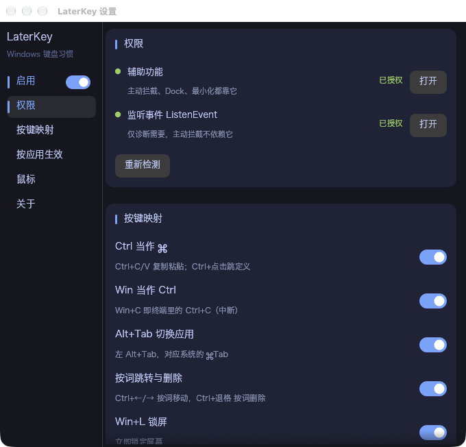

# V2EX 发帖文案

> 发到 `/go/create` 或「MacOS」节点。标题直接用下面这个，正文按需删减。

## 标题（二选一）

- `[分享] 做了个不装驱动的改键工具，让普通键盘在 Mac 上按 Windows 手感工作`
- `Windows 键盘插 Mac 的复制粘贴痛点，我自己写了个工具解决了`

## 正文

最近入手了 Mac mini M4，配的是一块普通 Windows 布局键盘（就那种几十块的），没换 Mac 原装键盘。用下来最别扭的一件事：

**手指按 Ctrl+C，Mac 不认，得换成 Command+C。**

这不是习惯几天能解决的——写代码时 Ctrl+C/V/X/A/Z 是肌肉记忆，每次都要"翻译"一遍，很累。

### 试过的方案，都不满意

1. **系统自带的修饰键互换**：把 Ctrl 和 Command 对调。界面里复制粘贴是舒服了，但终端里的 Ctrl+C（中断信号）也没了，按 Win+C 又不对——它只做简单对调，分不清"这个 Ctrl 是复制还是中断"。
2. **Karabiner-Elements**：功能强，但要装 DriverKit 虚拟 HID 驱动、写 JSON 规则、授权一堆权限，升级系统还可能失效。为改几个键上一套驱动，有点重。
3. **跟着改习惯用 Command+C**：坚持了两天，还是频繁按错。

### 于是自己写了一个：LaterKey

核心思路一句话：**在用户态拦截按键，按角色分流，不装驱动。**

- 图形界面里：物理 Ctrl → Command，Ctrl+C/V/X/A/Z 按 Windows 手感走；
- 终端里：物理 Win → Control，Win+C 就是中断（SIGINT），Win+D 是 EOF；
- 不用判断当前在哪个应用，两套习惯同时成立。

除了复制粘贴，还顺手补齐了这些 Windows 习惯：

| 操作 | 按键 |
|---|---|
| 切换应用 | 左 Alt+Tab（系统原生切换器） |
| 锁屏 | Win+L |
| 按词移动/删除 | Ctrl+←/→、Ctrl+退格 |
| 剪贴板历史 | Win+V（带历史面板） |
| 跳转定义 / 多选文件 | Ctrl+鼠标点击 |
| 访达 F2 重命名、浏览器 F5 刷新 | F2 / F5 |
| Dock 再点最小化 | 再点一次前台 App 的 Dock 图标 |

每一项都能在设置面板里单独开关，改完立即生效。

### 和现有方案比

| | LaterKey | Karabiner | 系统修饰键互换 |
|---|---|---|---|
| 装驱动 | ❌ 不用 | ✅ DriverKit | ❌ |
| 配置 | 图形界面点点点 | 写 JSON | 只能两两互换 |
| 终端 Ctrl+C 中断 | Win+C 独立保留 | 要配应用排除 | 被换掉 |

纯用户态实现，**只依赖macOS 的辅助功能权限**（诊断用的监听事件权限可选），不开机加载驱动，升级 App 也不需要重新授权（同一个自签名证书）。

### 安装

```bash
brew install --cask crazykun/ailater/laterkey
```

或者从 Releases 下 dmg 拖进 /Applications。装完在「系统设置 › 隐私与安全性 › 辅助功能」里添加一次 LaterKey.app，打开就能用。开机自启在设置面板里勾选就行。

开源地址：https://github.com/ailater/LaterKey



Rust 写的，欢迎提 issue 和 PR。用普通键盘配 Mac 又被复制粘贴折磨的同学，可以试试。
