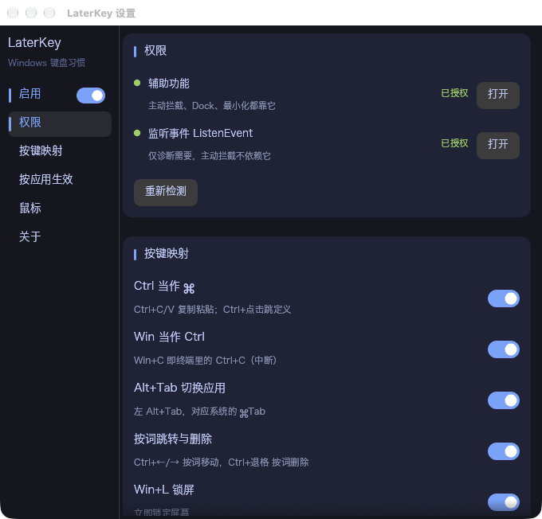

# 少数派投稿文案

> 适合「效率工具」「Mac 技巧」栏目。标题偏场景和情绪，正文讲清楚"为什么需要它"。

## 标题（三选一）

- `买了 Mac mini，我用一块普通键盘找回了 Windows 的手感`
- `不装驱动、不写 JSON：一个解决 Mac 复制粘贴别扭的小工具`
- `从 Windows 转 Mac，卡在 Ctrl+C 这件事上，我写了个工具`

## 正文

### 一块普通键盘，和一台新 Mac

前段时间入手了 Mac mini M4。机器很满意，但我没换键盘——手上那块普通的 Windows 布局键盘敲了几年，手感熟，没必要为了换系统就换掉。

然后就撞上了那堵墙：**按 Ctrl+C，Mac 没反应。**

写东西的时候，复制、粘贴、撤销、全选、保存、查找，全是 Ctrl 起手。到了 Mac 上全要换成 Command。我试过硬记，坚持两天，手指还是会下意识按 Ctrl——然后停下来，想想"哦，这里要按 Command"，思路就这么被打断了。

### 系统自带的方案，只解决了一半

macOS 在「键盘 › 修饰键」里能把 Control 和 Command 对调。改完之后界面里的复制粘贴顺了，但新问题来了：

**终端里的 Ctrl+C 是"中断当前命令"，不是复制。**

对调之后，你在终端按 Ctrl+C 想复制，发出去的却是中断信号；想中断，又得按 Win 键。一个简单对调分不清"这条命令是想复制还是想中断"，体验是割裂的。

### 我想要的其实很简单

- 写代码、看网页时，Ctrl+C 就是复制；
- 终端里，我想中断的时候按一个顺手的键就行；
- Alt+Tab 切应用、Win+L 锁屏这些 Windows 习惯，最好也能留着；
- 别让我装驱动、配规则文件、折腾一堆权限。

搜了一圈，Karabiner 能做，但它是个"重型武器"——要装 DriverKit 虚拟 HID 驱动、写 JSON 配置、授权输入监控。为了改几个键上一套驱动，我觉得不值当。

于是自己写了个小工具：**LaterKey**。

### 它怎么解决问题

核心是一句话：**修饰键按"角色"分流，而不是简单对调。**

- 图形界面里，物理 Ctrl 当作 Command —— Ctrl+C/V/X/A/Z 全部恢复 Windows 手感；
- 终端里，物理 Win 当作 Control —— Win+C 就是中断，Win+D 是 EOF；
- 两个角色各就各位，不用判断当前在哪个应用。

这个设计解决了系统自带方案那"一半"的问题：复制和中断不再打架，两套习惯同时成立。

除此之外，还顺手把常用的 Windows 操作补齐了：

- **Alt+Tab** 切应用（走系统原生切换器）；
- **Win+L** 锁屏；
- **Ctrl+←/→** 按词移动光标、**Ctrl+退格** 按词删除；
- **Win+V** 调出剪贴板历史面板，文本图片都能收；
- **Ctrl+鼠标点击** 在 VS Code 里跳定义、在浏览器里新标签打开、在访达里多选；
- 访达里 **F2** 重命名、浏览器里 **F5** 刷新；
- 再点一次前台 App 的 Dock 图标，窗口最小化。

每一项都能在设置面板里单独开关，改完立即生效。面板长这样：



### 安装和上手

```bash
brew install --cask crazykun/ailater/laterkey
```

或者从 GitHub Releases 下载 dmg。装完做两件事：

1. 去「系统设置 › 隐私与安全性 › 辅助功能」添加 LaterKey.app（只需要这一次，升级不用重新授权）；
2. 打开 App，菜单栏出现托盘图标就生效了。想开机自启，在设置面板里勾选「登录时自动启动」即可。

**它不装驱动、不用写 JSON、不联网，只依赖 macOS 的辅助功能权限。** 纯用户态实现，用 Rust 写的。

### 写在最后

这个工具是我在自己那台 Mac mini + 普通键盘上，从"忍着别扭"到"顺手解决"的产物。如果你也是从 Windows 转过来、不想换键盘、又被 Ctrl+C 折磨过，不妨试试。

GitHub：https://github.com/ailater/LaterKey （MIT 协议，欢迎 star 和反馈）

> 常见问题：和 Karabiner 不要同时用——两者都会改写键盘事件。迁移时先退出并卸载 Karabiner。
